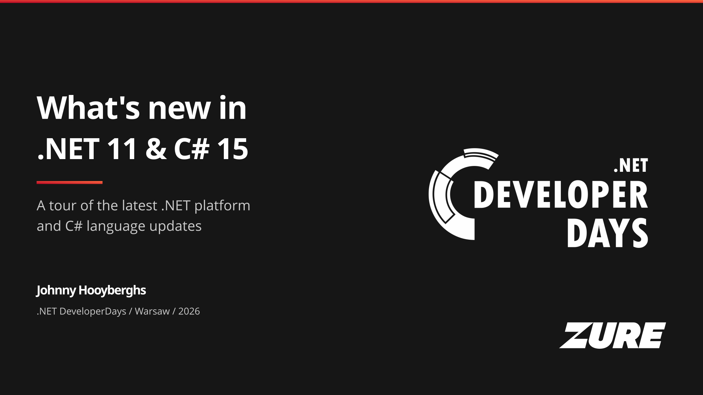
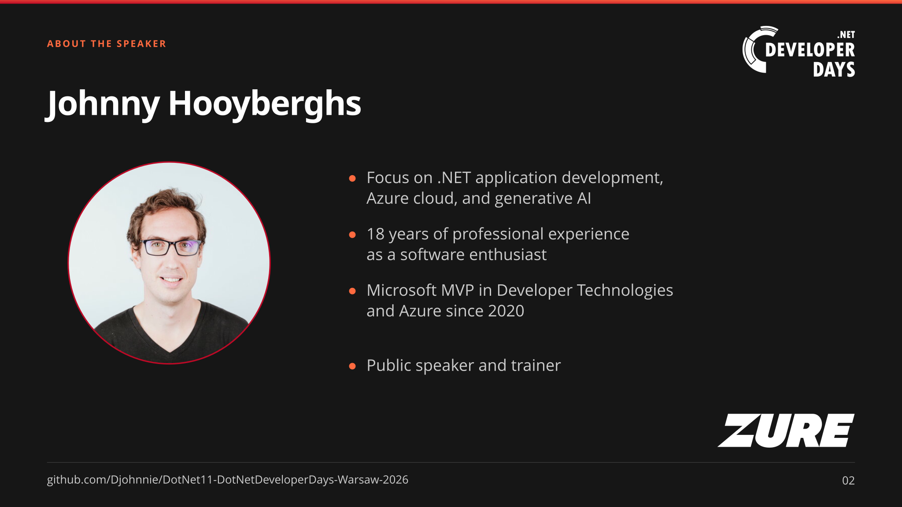
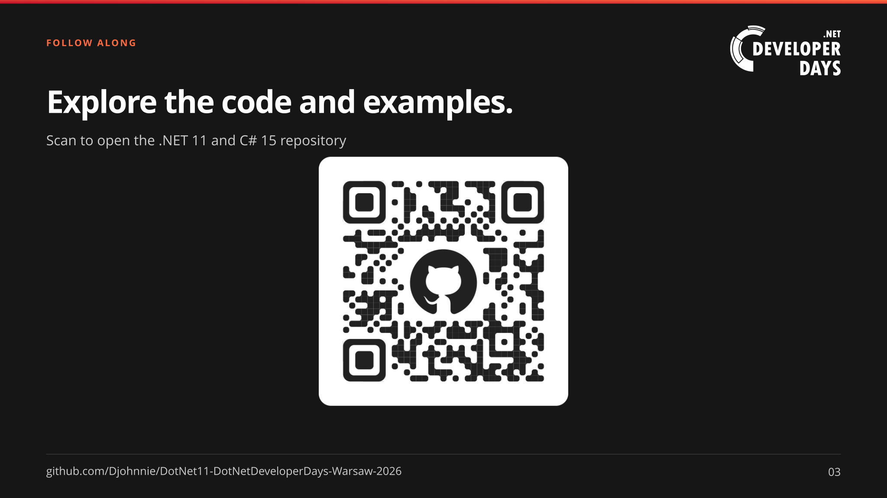

# What's new in .NET 11 and C# 15?

**.NET DeveloperDays Warsaw 2026**

Opening slides for a tour of the latest .NET platform and C# language updates.
The repository also contains runnable examples organized under `dotnet11`.

Build the PowerPoint with [`_tools\svg_to_pptx.ps1`](_tools/svg_to_pptx.ps1),
or regenerate its SVG sources with [`_tools\build-slides.ps1`](_tools/build-slides.ps1).
The [PowerPoint deck](DotNet11-DotNetDeveloperDays-Warsaw-2026.pptx) is also
included at the repository root. See [_tools\README.md](_tools/README.md) for
editing and export details.

## Opening slides

### 1. Title

### 2. About the speaker

### 3. Repository

The slide theme uses the supplied .NET DeveloperDays logo, speaker photo,
QR code, and Open Sans / Raleway fonts in `_resources`.
